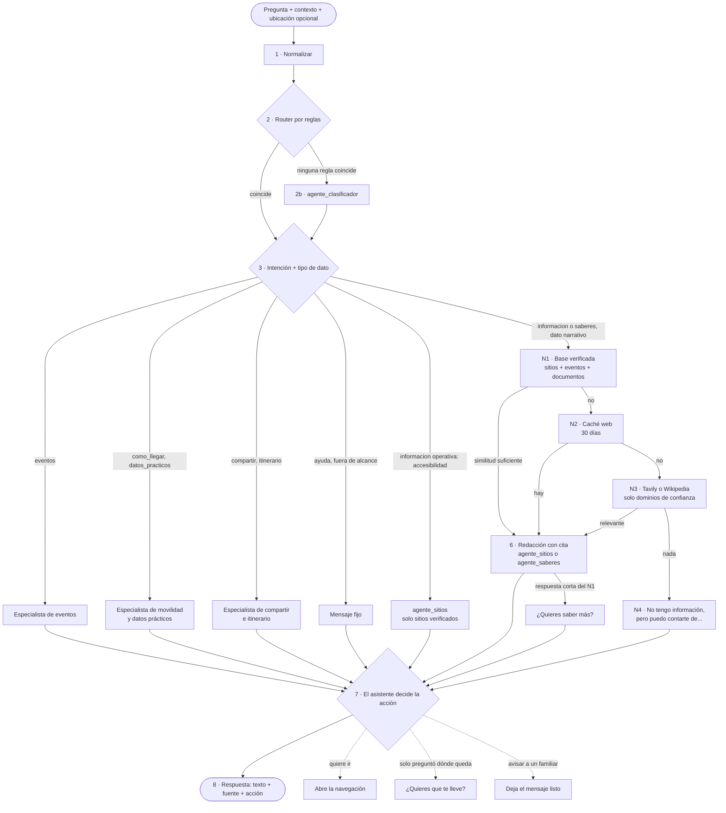

# Guía Cochala · Asistente turístico accesible para Cochabamba

Proyecto de grado de **Melany Aillen Chavarría Morales**, UNIFRANZ Cochabamba, 2026. Tutor: Ing. Richard Jiménez Velasco.

> **"Asistente virtual de turismo inclusivo: diseño de una plataforma multimodal para personas con diversas capacidades, con enfoque inicial en discapacidad visual."**

Guía Cochala es una aplicación móvil de **una sola pantalla**, sin registro, donde una abuela cochabambina animada responde por **voz, texto y avatar** sobre los sitios turísticos, los eventos y la cultura de Cochabamba. Está pensada primero para personas con **baja visión o ceguera**, y bajo los principios del Diseño Universal sirve a cualquier visitante.

---

## Lo que la hace especial

1. **Los datos de accesibilidad los verifica una persona, nunca una IA.** Piso táctil, braille, perros guía, nivel de ruido y la referencia de la entrada los registra una administradora a mano. Un dato sin registrar significa "sin información", nunca un valor inventado. Esa trazabilidad es el argumento central del proyecto.
2. **Regla de dos ejes: lo operativo no se inventa ni se busca en internet.** Si preguntas *dónde, cuándo, cuánto, horario o accesibilidad*, la respuesta sale solo de la base verificada. Si preguntas *qué es, de dónde viene, historia o leyenda*, el asistente recorre una cascada de fuentes citadas.
3. **Cada respuesta dice de dónde salió.** "Según la verificación de octubre de 2026", "según la Guía…, página 3" o "Según Wikipedia (información de internet)". Nunca inventa: si no sabe, lo dice y ofrece una alternativa de la base.
4. **El asistente decide el siguiente paso, sin botones.** Si quieres ir a un lugar, dice "Te abro la navegación" y la app abre tu aplicación de mapas al terminar de hablar. Si solo preguntas dónde queda, ofrece "¿Quieres que te lleve?" y abre el micrófono para escuchar tu "sí". Mientras habla, "Detener" cancela la acción.
5. **Un equipo de agentes por especialidad, coordinado por un grafo de decisión.** Un orquestador lee la pregunta, decide su intención y su tipo de dato, y se la entrega al especialista que corresponde: agentes con IA para redactar (clasificador, sitios, saberes) y especialistas sin IA para lo que debe ser exacto (eventos, cómo llegar, datos prácticos, compartir, itinerario). La IA es un apoyo, no el cerebro: si Gemini falla, da error de cuota o tarda más de 15 segundos, la respuesta sale igual con una plantilla que cita su fuente. Mira la sección [Arquitectura multiagente](#arquitectura-multiagente-por-especialidades).
6. **Privacidad por diseño.** No se guardan conversaciones, preguntas ni ubicaciones en el servidor. La ubicación solo se usa en la consulta que la necesita. El contacto de confianza vive solo en el teléfono. A los servicios externos nunca se les envía la ubicación ni datos personales.
7. **Costo cero.** Navegación con enlaces gratuitos (`geo:` y Google Maps sin clave), Wikipedia, Tavily (créditos gratuitos) y la capa gratuita de Gemini. No usa ninguna API de mapas de pago.
8. **Se comunica con todos los sentidos.** El estado del asistente se transmite por texto, voz, sonido y vibración, no solo con el avatar. Compatible con TalkBack, con tamaño mínimo de 48 dp, contraste 4,5:1 y respeto a "reducir animaciones".

---

## Arquitectura multiagente por especialidades

En lugar de un único modelo que "responde todo", el sistema funciona como un **equipo**: un orquestador (el grafo de decisión) y varios especialistas. Cada uno hace una sola cosa y la hace bien.

```
      App móvil (Flutter)            Bot de Telegram (opcional)
              │                                │
              └───────────────┬────────────────┘
                              ▼
              POST /api/consulta   (FastAPI · 20 consultas/min por IP)
                              │
                  ┌───────────▼────────────┐
                  │   ORQUESTADOR (grafo)   │  normaliza · router por reglas ·
                  │   asistente/servicios/  │  intención + tipo de dato · acción
                  └───────────┬────────────┘
     ┌───────────────┬────────┴───────┬─────────────────┐
     ▼               ▼                ▼                 ▼
 Especialistas   agente_clasificador  agente_sitios   agente_saberes
 SIN IA (SQL)    (Gemini, 1 llamada)  (Gemini, 1)     (Gemini, hasta 3)
 exactos y       solo si ninguna      sitios y        cascada N1→N2→N3→N4
 gratuitos       regla entiende       documentos      con herramientas
                                      verificados
```

### El equipo

| Especialista | ¿Usa IA? | Qué hace | Herramientas |
|---|---|---|---|
| **Orquestador** (grafo + router) | No | Normaliza el texto, aplica 13 reglas en orden de prioridad, decide la intención, el tipo de dato y la acción final | `decidir_accion` |
| **`agente_clasificador`** | Sí (1 solicitud) | Entra solo cuando ninguna regla entiende la pregunta; devuelve intención, tipo de dato y sitio nombrado | — |
| **`agente_sitios`** | Sí (1 solicitud) | Redacta sobre sitios, eventos y documentos verificados, con la fecha de verificación. No tiene acceso a internet | — |
| **`agente_saberes`** | Sí (hasta 3 solicitudes) | Responde gastronomía, tradiciones, leyendas, historia, quechua y más, recorriendo la cascada de fuentes | `buscar_en_base`, `buscar_en_cache`, `buscar_web` |
| **Especialista de eventos** | No | Eventos del rango pedido, el más cercano primero, con hora y distancia | `eventos_por_fecha`, `eventos_de_hoy` |
| **Especialista de movilidad** | No | Lee la referencia de la entrada y la distancia; decide si abrir la navegación o preguntar | `como_llegar`, `decidir_accion` |
| **Especialista de compartir e itinerario** | No | Deja el mensaje listo para un familiar; arma recorridos de 2 a 4 sitios | `armar_mensaje_compartir`, `armar_itinerario` |
| **Especialista de datos prácticos** | No | Horario, costo, duración y servicios, o "no está registrado" | `datos_practicos` |

**¿Por qué así?** Lo que debe ser exacto (horarios, distancias, accesibilidad) no pasa por la IA, así que no puede inventarse y no cuesta nada. La IA se reserva para entender frases ambiguas y redactar con calidez. Cada agente tiene instrucciones en español, salida tipada con Pydantic y límites de solicitudes, y se prueba con modelos falsos sin gastar cuota.

### El grafo de decisión

Cada paso es una función explícita de [`asistente/servicios/grafo.py`](asistente/servicios/grafo.py): sin librerías de orquestación, fácil de leer, probar y explicar.



El diagrama completo y detallado está en [`docs/grafo_asistente.mmd`](docs/grafo_asistente.mmd).

### El router por reglas

Las reglas se revisan **en este orden** y gana la primera que coincide. No hay IA en este paso, así que es rápido, gratis y predecible. Acierta el 100 % de las 77 preguntas del conjunto de pruebas.

| # | Intención | Se activa con palabras como… | Lo atiende |
|---|---|---|---|
| 1 | `confirmacion` | "sí", "dale", "claro" / "no", "mejor no" (solo si hay una acción pendiente) | Orquestador |
| 2 | `mas_informacion` | "cuéntame más", "quiero saber más" | `agente_saberes` |
| 3 | `ayuda` | "¿qué puedes hacer?", "ayuda" | Mensaje fijo |
| 4 | `compartir` | "avisa a mi familia", "dile dónde estoy" | Compartir |
| 5 | `como_llegar` | "¿cómo llego?", "llévame", "¿dónde queda?" | Movilidad |
| 6 | `itinerario` | "arma un recorrido", "plan para hoy" | Itinerario |
| 7 | `eventos` | "feria", "¿qué hay hoy?", "¿cuándo es?" | Eventos |
| 8 | `datos_practicos` | "horario", "¿cuánto cuesta?", "¿cuánto tiempo?" | Datos prácticos |
| 9 | `cercania` | "¿qué hay cerca de mí?" | Cercanía (SQL) |
| 10 | `informacion` (por sitio) | si nombra un sitio verificado, siempre va aquí | `agente_sitios` |
| 11 | `saberes` | "leyenda", "silpancho", "quechua", "artesanía", "historia de Cochabamba" | `agente_saberes` |
| 12 | `fuera_de_alcance` | política, fútbol, clima, dólar… | Mensaje fijo |
| 13 | `informacion` (general) | "cuéntame", "¿qué es?", "piso táctil", "lugar tranquilo" | `agente_sitios` |
| — | sin coincidencia | cualquier otra frase | `agente_clasificador` |

### Ejemplos: cómo viaja una pregunta

| Pregunta | Camino | Resultado |
|---|---|---|
| "¿Cómo llego a la Catedral?" | Regla 5 → especialista de movilidad → acción | Lee la referencia de la entrada y la distancia, dice "Te abro la navegación" y la app abre el mapa. **0 llamadas a la IA** |
| "¿Qué es el silpancho?" | Regla 11 → N1 (no hay) → N2 (no hay) → N3 (Tavily/Wikipedia) | "Según Wikipedia (información de internet)…", con la URL. La segunda vez sale de la caché con 0 créditos |
| "Cuéntame la leyenda de la piedra que canta" | Regla 11 → N1 encuentra un documento verificado | "…según la Guía…, página 1." Luego ofrece "¿Quieres saber más?" |
| "¿Cuánto cuesta un silpancho?" | Regla 8, dato **operativo** | "No tengo ese dato verificado." **Nunca** va a internet |
| "Me da curiosidad lo que comen los cochabambinos" | Sin regla → `agente_clasificador` → `saberes` | Entra a la cascada de saberes |
| "Cuéntame del Museo del Louvre" | Lugar con nombre propio que no está en la base | "No tengo información sobre Museo del Louvre. Puedo contarte de los museos de Cochabamba que tengo registrados." |
| "¿Qué es la chicha y dónde la puedo probar?" | Pregunta compuesta: narrativa + operativa | Cada parte sigue su regla y se unen |

---

## Funcionalidades

### 1. Asistente conversacional

- **Orquestador y agentes por especialidad**: ver [Arquitectura multiagente](#arquitectura-multiagente-por-especialidades).
- **Búsqueda híbrida** en PostgreSQL con pgvector: coincidencia por nombre del sitio, búsqueda semántica (distancia coseno, modelo `paraphrase-multilingual-mpnet-base-v2`) y filtros SQL exactos ("tranquilo" → ruido bajo, "piso táctil", "perro guía", tipo de lugar). Solo se ven los sitios `verificado`.
- **Preguntas compuestas** ("¿Qué es la chicha y dónde la puedo probar?"): se dividen en parte narrativa y parte operativa, y cada una sigue su regla.
- **"¿Quieres saber más?"**: si la respuesta salió de la base y es corta, la abuela ofrece profundizar y, con un "sí", baja al siguiente nivel de la cascada.
- **Lugares inexistentes o de otra ciudad**: "Cuéntame del Museo del Louvre" responde "No tengo información sobre Museo del Louvre. Puedo contarte de los museos de Cochabamba que tengo registrados."

### 2. Cascada de fuentes para lo narrativo

| Nivel | Fuente | Cita |
|---|---|---|
| N1 | Sitios, eventos y **documentos verificados** | "según la verificación de…" / "según la Guía…, página n" |
| N2 | Caché de contenido de internet (30 días) | "Según Wikipedia (información de internet)…" |
| N3 | **Tavily** (solo dominios de confianza) y, de respaldo, Wikipedia directa | igual que N2 |
| N4 | Nada sirvió | "No tengo información sobre eso, pero puedo contarte de…" |

El orden lo impone el código: la web se niega si antes no se consultaron la base y la caché. Lo que no es de Cochabamba o Bolivia, o es ajeno al turismo (clima, noticias, política, deportes), nunca va a internet.

### 3. Panel de administración web

- Inicio de sesión con contraseña **bcrypt**.
- **Sitios**: crear, editar, filtrar por estado y verificar. Todo sitio nuevo entra como borrador; al verificar se registran quién y cuándo. Editar un sitio verificado lo devuelve a borrador. Al guardar se regenera su embedding.
- **Eventos** con fecha, hora, zona y coordenadas (copiables desde Google Maps).
- **Documentos**: subir PDF, DOCX o TXT con permiso de uso obligatorio; extracción de texto con página; fragmentos de unos 800 caracteres; vista previa; verificar, reemplazar y eliminar con confirmación. Un PDF escaneado como imagen se rechaza.
- **Contenido traído de internet**: lista de lo que el asistente consultó en la web. Se puede convertir en documento (en borrador, con su licencia) o descartar.
- HTML semántico, etiquetas `label`, buen contraste y navegable con teclado.

### 4. App móvil (Flutter, Android)

- **Pantalla única** con el avatar Rive, fondo de paisaje cochabambino difuminado con zoom lento, nubes, pétalos de jacarandá y el botón Hablar con halo y anillos.
- **Tarjeta "Hoy"**: eventos del día, el más cercano primero ("Hoy cerca de ti · Feria X · a 800 m · hasta las 18:00"), con el botón "Escuchar eventos de hoy". La abuela anuncia el primero al abrir.
- **Línea de fuente** bajo cada respuesta ("Fuente: Wikipedia" o "Verificado el 12/10/2026").
- **Estados con texto, voz, sonido y vibración**: En espera, Escuchando, Buscando información, Hablando, Abriendo navegación y error.
- **"¿Cómo llego?"**: la abuela lee la referencia de la entrada y la distancia, y abre tu app de mapas con `geo:` (respaldo: URL de Google Maps).
- **Avisar a un familiar y compartir el recorrido**: deja el mensaje listo en WhatsApp o en la hoja de compartir; la persona pulsa enviar. La ubicación se incluye solo si la pide ("dile dónde estoy").
- **Itinerario**: de 2 a 4 sitios cercanos en orden de recorrido, más los eventos de hoy.
- **Ajustes** (solo en el teléfono): velocidad de la voz, anuncio de eventos, aviso diario, sonidos, vibración y contacto de confianza.
- **Aviso diario de eventos** opcional (notificación local, sin Firebase ni cuentas).
- **Ayuda por voz** con ejemplos de preguntas.

### 5. Bot de Telegram (opcional)

Usa el mismo asistente con `canal = telegram`. Comandos `/eventos`, `/itinerario` y `/ayuda`. No guarda `chat_id`, suscripciones ni conversaciones. Sin `TELEGRAM_TOKEN` no arranca.

### 6. Métricas para la tesis

Cada consulta guarda una fila **sin datos personales** en `metricas_consulta`: intención, tipo de dato, nivel de fuente, si usó IA y por qué no, créditos de Tavily, similitud y tiempo. Sirve para medir qué porcentaje se resuelve sin IA, con la base, con documentos, con la caché o con la web.

---

## Tecnologías

| Parte | Tecnología |
|---|---|
| Backend y panel | Python 3.12, FastAPI, Jinja2, slowapi |
| Base de datos | PostgreSQL 16 con pgvector (índice HNSW) |
| Embeddings | sentence-transformers `paraphrase-multilingual-mpnet-base-v2` (768 dimensiones) |
| Agentes | Pydantic AI con Gemini |
| Web | Tavily (con dominios de confianza) y Wikipedia |
| Documentos | pypdf, python-docx |
| App móvil | Flutter, Rive, speech_to_text, flutter_tts, geolocator, url_launcher, share_plus, audioplayers, workmanager |
| Despliegue local | Docker y Docker Compose |
| Pruebas | pytest, Ragas (preparado) |

---

## Cómo ejecutarlo

Todo el código Python se ejecuta dentro de Docker.

### Requisitos
Docker Desktop, Flutter, el SDK de Android y un contenedor de PostgreSQL con pgvector llamado `postgres-tesis` (imagen `pgvector/pgvector:pg16`, base `turismo_db`, usuario `postgres`).

### 1. Configuración
```powershell
Copy-Item .env.ejemplo .env
Copy-Item panel\.env.example panel\.env
```
Abre `.env` y completa los valores (nunca los subas a git):

| Variable | Para qué |
|---|---|
| `LLM_PROVEEDOR`, `LLM_MODELO`, `GOOGLE_API_KEY` (o `LLM_API_KEY`) | Gemini ([clave gratuita](https://aistudio.google.com/apikey)) |
| `TAVILY_API_KEY`, `TAVILY_SCORE_MIN`, `DOMINIOS_CONFIABLES` | Búsqueda web ([clave gratuita](https://app.tavily.com)) |
| `WIKIPEDIA_CONTACTO` | Contacto que exige Wikimedia en el User-Agent |
| `UMBRAL`, `MARGEN`, `TOP_K` | Calibración de la búsqueda |
| `TELEGRAM_TOKEN` | Solo si usas el bot |

Sin las claves el sistema igual funciona, con plantillas y Wikipedia directa.

### 2. Base de datos
Las migraciones están en [`migraciones/`](migraciones) (001 a 010) y se aplican en orden. Para ver el sistema funcionando hay datos **ficticios** (`datos_prueba.sql`, `datos_prueba_eventos_ubicacion.sql` y `cargar_documento_prueba.py`) que se borran con `borrar_datos_prueba.sql` antes de usar datos reales.

### 3. Levantar backend y panel
```powershell
docker start postgres-tesis
docker compose up -d backend panel
```
- API: http://localhost:8000 (revisa `/api/estado`)
- Panel: http://localhost:8080

### 4. App en un teléfono Android por USB
```powershell
adb devices
adb reverse tcp:8000 tcp:8000
cd flutter_application_1
flutter run --dart-define=API_URL=http://localhost:8000
```
En el emulador de Android Studio no hace falta configurar nada: la app usa `http://10.0.2.2:8000`.

### 5. Pruebas
```powershell
docker compose run --rm backend python -m pytest /app/pruebas -q
docker compose run --rm panel python -m pytest /app/pruebas/test_panel_documentos.py -q -p no:cacheprovider
docker compose run --rm backend python pruebas/probar_guia.py
cd flutter_application_1; flutter test
```
Las pruebas del backend no gastan cuota de Gemini ni créditos de Tavily. `pruebas/probar_guia.py` ejecuta las filas automatizables de [`docs/guia_pruebas.md`](docs/guia_pruebas.md).

---

## Estructura del proyecto

```
├── asistente/            Backend: API, router, grafo, cascada, agentes y herramientas
│   ├── api/              /api/consulta, /api/eventos/hoy, /api/estado
│   └── servicios/        grafo.py, router_reglas.py, cascada.py, agentes/, herramientas/
├── panel/                Panel de administración (sitios, eventos, documentos, contenido web)
├── flutter_application_1/  App móvil
├── migraciones/          Cambios de esquema numerados
├── pruebas/              Pruebas automáticas y preguntas del router
├── docs/                 Grafo, guía de pruebas, informes
└── docker-compose.yml    Backend (8000) y panel (8080)
```

---

## Privacidad y datos

- No se guardan conversaciones, preguntas ni ubicaciones en el servidor.
- A Gemini y Tavily solo se les envía el texto de la pregunta, sin correos ni números largos, y el contexto recuperado. En la capa gratuita de Gemini, Google puede usar el contenido para mejorar sus productos; por eso no se envían datos personales.
- Los datos de prueba incluidos son **inventados**. No representan información real de ningún sitio.
- El texto de Wikipedia se usa bajo licencia CC BY-SA 4.0 y siempre se cita su URL.

## Estado y trabajo futuro

Hecho: panel, asistente con RAG y cascada de fuentes, documentos, agentes, app móvil con sonidos, vibración, acciones, ajustes y aviso diario, y bot de Telegram.

Pendiente o futuro: pruebas con personas con discapacidad visual, calibración de umbrales con datos reales, evaluación con Ragas, interfaz para otras discapacidades (auditiva y motora), modo sin conexión, quechua e inglés, y un servidor MCP que exponga las herramientas.

## Autoría

Melany Aillen Chavarría Morales · Proyecto de grado, UNIFRANZ Cochabamba, 2026.
